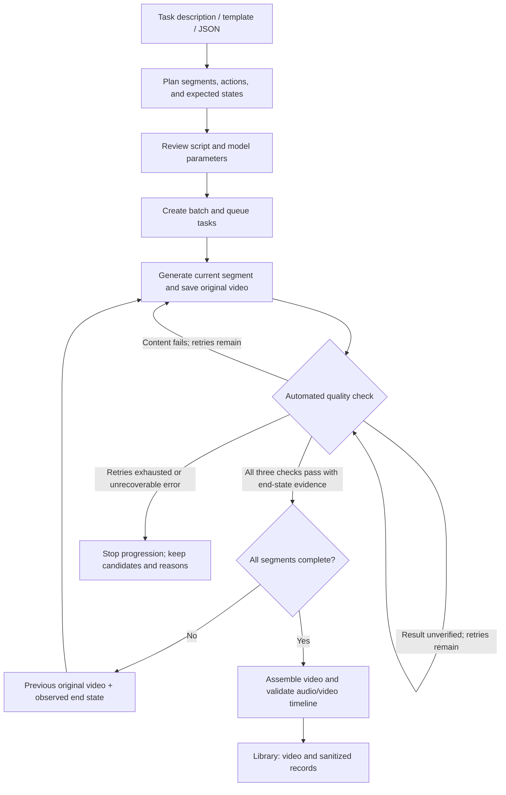
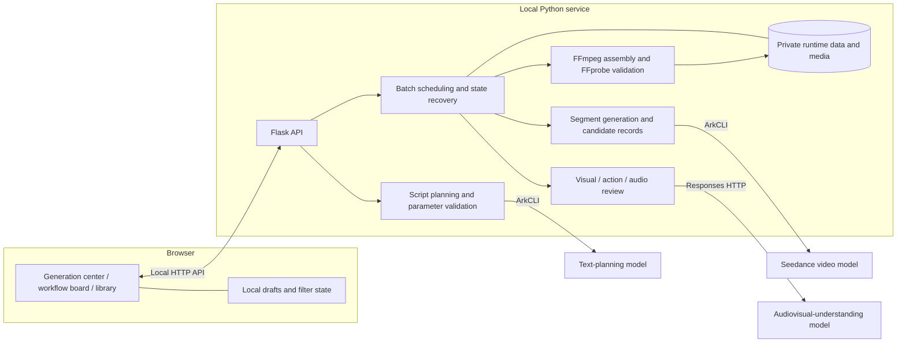

<div align="center">
  
  <h1>Embodied Intelligence Data Generator</h1>
  <p><strong>Turn task descriptions into continuous video and traceable embodied data.</strong></p>
  <p><a href="README.md">简体中文</a> · <a href="README.en.md">English</a></p>
  <p>
    <a href="LICENSE"></a>
    <a href="https://github.com/YuhaoYeSteve/embodied-data-generator/actions/workflows/ci.yml"></a>
  </p>
  <p>
    
    
    
    
  </p>
  <p>
    <a href="https://github.com/YuhaoYeSteve/embodied-data-generator/stargazers"></a>
    <a href="https://github.com/YuhaoYeSteve/embodied-data-generator/forks"></a>
    <a href="https://github.com/YuhaoYeSteve/embodied-data-generator/watchers"></a>
    <a href="https://github.com/YuhaoYeSteve/embodied-data-generator/issues"></a>
    <a href="https://github.com/YuhaoYeSteve/embodied-data-generator/pulls"></a>
  </p>
  <p><a href="#quick-start">Quick start</a> · <a href="#architecture">Architecture</a> · <a href="#community">Contribute</a> · <a href="#star-history">Star History</a> · <a href="#license">License</a></p>
</div>

---

Turn natural-language tasks or structured scripts into continuous videos, task labels, and traceable generation records. Designed for object manipulation, human interaction, and collaborative scenarios, the project covers the full workflow from task planning and segment generation to automated quality checks and finished-video management.

The project provides a local web workspace with built-in **Seedance 2.0 / Seedance 2.5** video-generation adapters. Scenarios and scripts can be reused, edited, and extended. Supporting another model requires implementing its capability validation and API adapter.

The web interface and built-in script planner currently use Chinese.

For page navigation, drafts, reference media, and task recovery, see the [Workspace guide (Chinese)](WEB_STUDIO.md).

## Workspace preview

Captured in a dedicated demo workspace, without customer tasks or customer media.

**Generation center · Creative inputs and video parameters in separate groups**


**Output library · Preview, download, and reuse generated results**


## Original demo video

A first-person geometric-object sorting demo made specifically for this project. Seedance 2.5 · 60 seconds · 480p · 4 continuous segments; automated visual, action, and audio checks passed.

https://github.com/user-attachments/assets/e7a996de-332b-4fb0-b21c-3682f62977a5

## Core capabilities

- **Task-to-script planning:** Describe the environment, goals, objects, and actions to generate multiple task variants, or start from a template or imported JSON.
- **Model-aware parameter validation:** A shared capability catalog defines models, resolutions, and segment durations, with validation in both frontend controls and backend submission.
- **Continuous segment generation:** Each segment uses the preceding segment's original video and the actual end state recorded by automated review. Segments run sequentially within a video; multiple videos can run concurrently.
- **Automated quality checks:** Evaluate visual continuity, action completeness, and audio consistency separately. Regeneration and rechecking follow bounded retry policies, without manual acceptance of each segment.
- **Recoverable task management:** Persist task IDs, candidate segments, and review records, with pause, resume, failure retry, and re-running exports.
- **Informational cost estimates:** Display estimated and unknown costs without budget approval or budget-based blocking of workspace tasks.

## Three workspaces

| Workspace | Purpose |
| --- | --- |
| Generation center `/#/create` | Enter task inputs and output specifications in step one, then review and edit the script before starting generation in step two |
| Workflow board `/#/board` | Track batches, videos, segments, automated reviews, costs, and logs; pause and resume tasks |
| Finished-video library `/#/library` | Search, preview, and download complete videos; trace source tasks and reuse scripts and parameters in new drafts |

The creation page groups **creative inputs**—task descriptions, goals, variation requirements, templates, and reference media—separately from **video parameters**—model, resolution, total duration, segment duration, video count, and concurrency. Drafts are stored in the current browser. Switching pages does not interrupt submitted tasks.

<a id="quick-start"></a>

## Quick start: local simulation

Requires Python 3.9+, FFmpeg, and FFprobe. The current implementation uses POSIX file locks and is suited to macOS and Linux; Windows users can run it in WSL. Install FFmpeg through your system package manager and ensure both `ffmpeg` and `ffprobe` are on your PATH.

Run the following from the project root:

```bash
python3 -m venv .venv
source .venv/bin/activate
python -m pip install -r requirements-web.txt
python -B studio_server.py --simulate --port 8790 --open
```

Open the [local simulation workspace](http://127.0.0.1:8790/). Choose the generic object-sorting template or enter a task description, for example:

> From a first-person perspective, sort parts of different shapes on a workbench into matching storage boxes, check for any missed parts, and close the lids.

Simulation mode creates local test media marked `SIMULATION` and exercises the script, queue, review, and assembly workflow. **It requires no credentials and makes no model calls.** Simulated review results validate the software workflow only.

Simulation data is stored in `.studio-simulation/` by default. Use `--data-dir` to choose another directory. Simulation and real generation must use separate data directories.

<a id="configuration"></a>

## Configure real generation

Real generation additionally requires **ArkCLI** configured with your account and access to the selected video, text-planning, and audiovisual-understanding models. Video generation and script expansion use ArkCLI. Automated review calls the Responses HTTP API using credentials from the selected ArkCLI profile.

Copy the public configuration example and fill in your local settings:

```bash
cp studio.config.example.json studio.local.json
```

| Setting | Description |
| --- | --- |
| `video_profile` | ArkCLI profile for video generation; defaults to `default` |
| `planner_profile`, `review_profile` | Profiles for script planning and automated review; inherit `video_profile` when omitted |
| `planner_model` | An authorized text-planning model or endpoint capable of producing the required JSON |
| `review_model` | An authorized audiovisual-understanding model or endpoint supporting the current video and audio input formats |
| `video_models` | Per-model overrides for video calls; built-in public foundation-model IDs are used by default |
| `video_prices_cny_per_1k_tokens` | Optional video rates for cost display |
| `review_prices_cny_per_1m_tokens` | Optional review rates for cost display |

Use `studio.config.example.json` as the configuration reference. `planner_model` and `review_model` are empty by default and must be configured before real script expansion and review. The current review HTTP adapter uses the Beijing-region API, so `review_profile` must be a Platform Profile in `cn-beijing`. Unconfigured rates remain unknown: they are not treated as free and do not block workspace generation.

Use `studio.local.json` for settings only. Do not put AK, SK, or API keys in it; credentials are managed by your local ArkCLI installation. To store the configuration elsewhere, set `STUDIO_CONFIG_PATH` to its file path. Restart the service after changing configuration.

```bash
python -B studio_server.py --open
```

Open the [real-generation workspace](http://127.0.0.1:8787/). The service listens only on the local machine and stores data in `.studio/` by default. Real script expansion, video generation, and automated review call model services. Restarting the service recovers started tasks; paused tasks remain paused.

<a id="workflow"></a>

## Generation workflow



Continuation uses the preceding segment's complete original video, rather than the accumulated full-length video. Expected states describe the goal; the continuation starting point is grounded in review observations. Passing automated checks does not guarantee physical realism or correctness of every detail. Generated data still needs evaluation for its downstream use.

If submission has an ambiguous outcome and no task ID is available, the system retains `submission_unknown` and does not blindly resubmit. Query or download failures can resume the original task, and assembly failures can reuse existing segments. Failed candidates and retry records are retained rather than overwritten.

## Current model capabilities

These are the project's built-in parameter constraints. Actual availability also depends on the service and your account permissions.

| Model | Resolutions | Segment duration | Default segment duration |
| --- | --- | --- | --- |
| Seedance 2.0 | 480P, 720P, 1080P, 4K | 4–15 seconds, integer values | 15 seconds |
| Seedance 2.5 | 480P, 720P, 1080P | 4–30 seconds, integer values | 30 seconds |

A complete workspace script contains 2–20 segments and totals at least 60 seconds. The upper limit depends on the model and segment duration. Scenario expansion offers 60 / 90 / 120 / 180-second options. For example, a 60-second video defaults to 4 × 15-second segments with 2.0, or 2 × 30-second segments with 2.5. Switching models never silently truncates an existing script; incompatible content must be adjusted.

<a id="architecture"></a>

## System architecture



State is persisted to files, with no separate database deployment required. Segments execute sequentially within each video, while a batch can run 1–3 videos concurrently. The workspace coordinates quality decisions and recovery policies.

## Outputs and data boundaries

| Output | Meaning |
| --- | --- |
| Complete videos and original segments | Model-generated visual content, actions, and audio; complete videos undergo media validation |
| Task, object, and action labels | Script-planning information marked `annotation_scope: planned` |
| Review conclusions and end states | The audiovisual model's observations and evidence from generated video, recorded separately from the script's expected states |
| Task and candidate ledgers | Traceability records covering model parameters, segment requests, task status, retries, usage, and estimable costs |

The project does not currently collect robot sensor data or directly produce joint trajectories, control actions, depth, force-control data, or calibration ground truth. Planned labels are not frame-level video annotations. Training use requires additional annotation validation and conversion to the required data format.

The library provides video and sanitized metadata downloads. Raw runtime directories may contain prompts, uploaded media, model responses, and signed media URLs. These are private local data and should not be committed with the source code. Exported videos preserve the video frames; their audio is a derived track re-encoded after timeline alignment.

## Project structure

```text
web/                         Frontend for the three workspaces
studio_server.py             Local HTTP API and startup entry point
studio_backend.py            Batch queue, automatic progression, and recovery
studio_config.py             Local runtime configuration
studio_models.py             Model capabilities and parameter constraints
studio_scenarios.py          Task expansion and planned-label validation
studio_review.py             Automated quality decisions
longform_pipeline.py         Segment execution, candidate records, and continuation
longform_client.py           ArkCLI video-call adapter
review_api.py                Audiovisual review API adapter
assemble_review.py           Media assembly and integrity validation
scenarios/                   Editable structured task templates
tests/                       Backend, frontend, and media-processing tests
studio.config.example.json   Credential-free configuration example
```

## Development checks

Frontend tests require Node.js 18+. Some media tests require FFmpeg and FFprobe. Tests use local samples, simulation, or test doubles and do not require real model credentials.

```bash
python -B -m unittest discover -s tests -q
node --test tests/test_studio_frontend.js tests/test_workspace_core.js tests/test_generation_workspace.js tests/test_workspaces.js
```

When changing model capabilities, check `studio_models.py`, request adapters, script planning, and parameter validation on both the frontend and backend. Changes to automated review or recovery policies should be verified for compatibility with existing tasks and candidate records.

<a id="community"></a>

## Community and contributing

If this project is useful to you, consider giving it a Star. Choose **Watch → Custom** at the top of the repository to subscribe to the issues, pull requests, and other activity you care about.

| I want to… | Start here |
| --- | --- |
| Support or bookmark the project | [Open the repository](https://github.com/YuhaoYeSteve/embodied-data-generator) and click Star |
| Report a problem | [File a bug](https://github.com/YuhaoYeSteve/embodied-data-generator/issues/new?template=bug_report.yml) with reproduction steps |
| Suggest an improvement | [Request a feature](https://github.com/YuhaoYeSteve/embodied-data-generator/issues/new?template=feature_request.yml) |
| Improve code or documentation | Read the [contribution guide](CONTRIBUTING.md), then open a pull request |
| Check test results | Browse the [CI runs](https://github.com/YuhaoYeSteve/embodied-data-generator/actions/workflows/ci.yml) |

Contributions are welcome: reusable task templates, model adapters, continuity and quality checks, workspace improvements, and documentation translations. Use reference media and logs that are suitable for public sharing.

<a id="star-history"></a>

## Star History

<a href="https://www.star-history.com/">
  <picture>
    <source media="(prefers-color-scheme: dark)" srcset="docs/assets/community/star-history-dark.svg">
    <source media="(prefers-color-scheme: light)" srcset="docs/assets/community/star-history.svg">
    
  </picture>
</a>

<a id="license"></a>

## License

The source code is licensed under the [Apache License 2.0](LICENSE), permitting use, modification, and distribution under its terms. Model services, third-party dependencies, and external media remain subject to their own terms; the source license does not grant rights to those materials.

Copyright © 2026 YuhaoYeSteve.

<p align="center"><a href="#quick-start">Generate your first dataset →</a></p>
