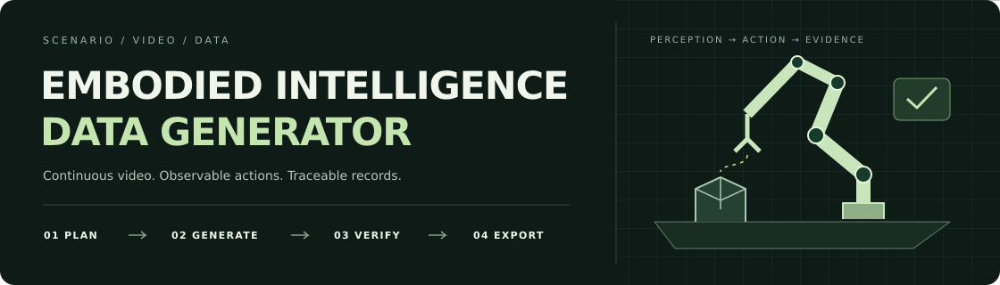
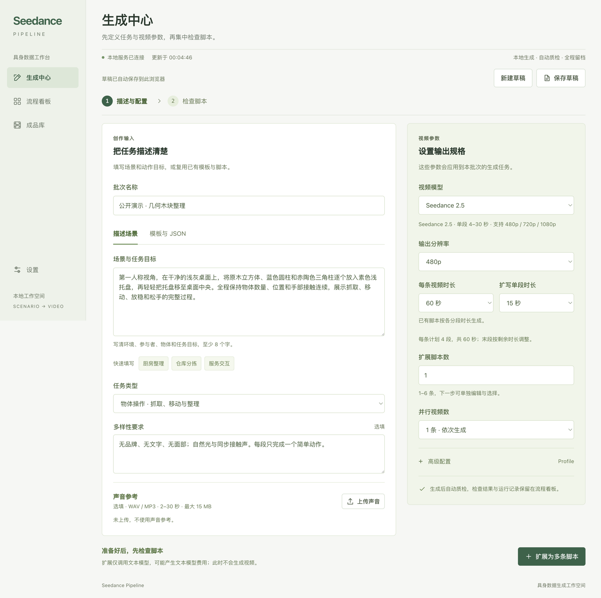
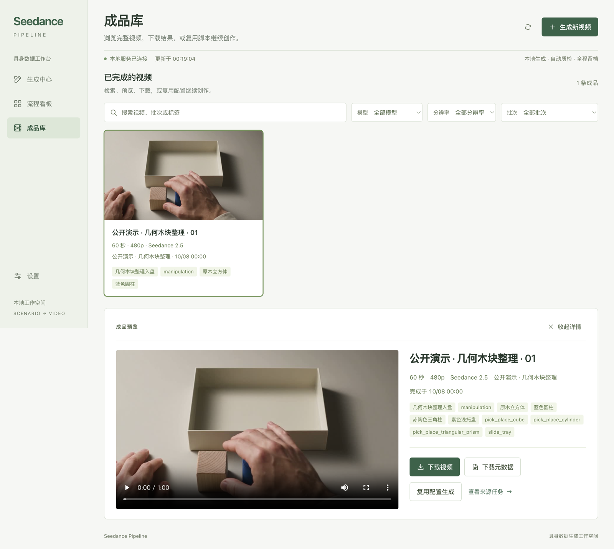
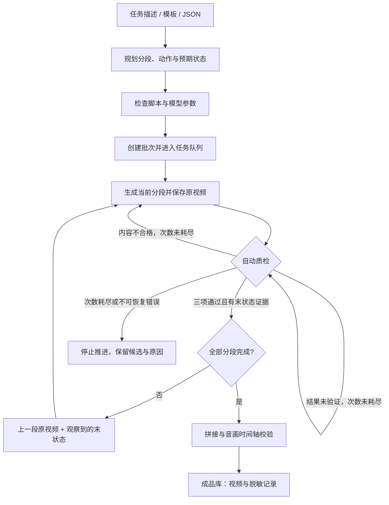
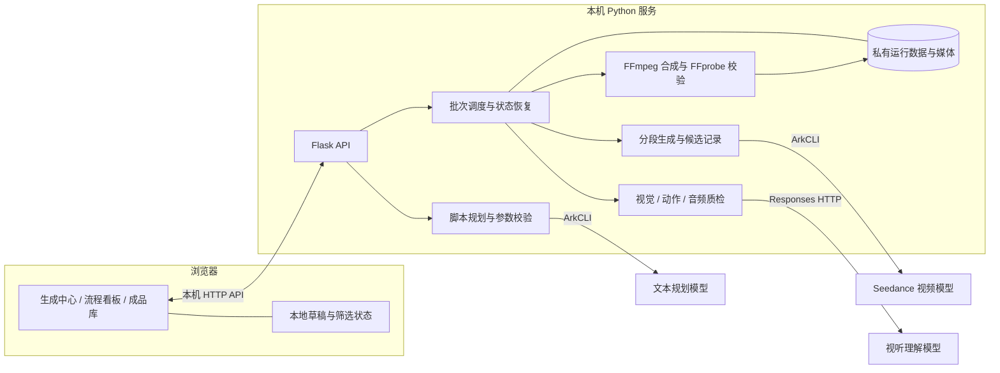
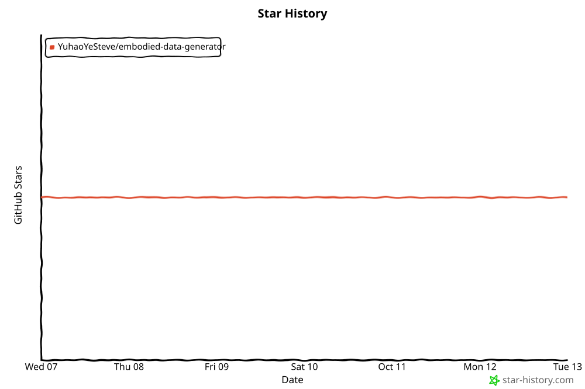

<div align="center">
  
  <h1>具身智能数据生成器</h1>
  <p><strong>把任务描述变成连续视频与可追溯的具身数据。</strong></p>
  <p><a href="README.md">简体中文</a> · <a href="README.en.md">English</a></p>
  <p>
    <a href="LICENSE"></a>
    <a href="https://github.com/YuhaoYeSteve/embodied-data-generator/actions/workflows/ci.yml"></a>
  </p>
  <p>
    
    
    
    
  </p>
  <p>
    <a href="https://github.com/YuhaoYeSteve/embodied-data-generator/stargazers"></a>
    <a href="https://github.com/YuhaoYeSteve/embodied-data-generator/forks"></a>
    <a href="https://github.com/YuhaoYeSteve/embodied-data-generator/watchers"></a>
    <a href="https://github.com/YuhaoYeSteve/embodied-data-generator/issues"></a>
    <a href="https://github.com/YuhaoYeSteve/embodied-data-generator/pulls"></a>
  </p>
  <p><a href="#quick-start">快速开始</a> · <a href="#architecture">系统架构</a> · <a href="#community">参与贡献</a> · <a href="#star-history">Star History</a> · <a href="#license">许可证</a></p>
</div>

---

将自然语言任务或结构化脚本转换为连续视频、任务标签和可追溯的生成记录。面向物体操作、人际交互与协作等场景，支持从任务规划、分段生成、自动质检到成片管理的完整流程。

项目提供本地 Web 工作台，当前内置 **Seedance 2.0 / Seedance 2.5** 视频生成适配。场景和脚本可以复用、修改与扩展；接入其他模型需要实现对应的能力校验和调用适配。

页面操作、草稿、参考素材和任务恢复详见 [工作台操作指南](WEB_STUDIO.md)。

## 系统预览

以下截图来自独立演示环境，未使用客户任务或客户素材。

**生成中心 · 分组配置创作输入与视频参数**



**成品库 · 预览、下载并复用生成结果**



## 全新演示视频

专为项目展示制作的第一人称几何物体整理示例。Seedance 2.5 · 60 秒 · 480p · 4 段连续生成；画面、动作与声音自动检查通过。

https://github.com/user-attachments/assets/e7a996de-332b-4fb0-b21c-3682f62977a5

## 核心能力

- **从任务生成脚本**：输入环境、目标、物体和动作要求，扩写为多个任务变体，也可使用模板或导入 JSON。
- **按模型校验参数**：型号、分辨率和单段时长共用一份能力目录，前端选项与后端提交同时校验。
- **连续分段生成**：下一段使用上一段原视频及自动质检记录的实际末状态，逐段推进；多条视频可并发执行。
- **自动质量检查**：分别检查视觉连续性、动作完整性与声音一致性，按限次策略重生成或复查，无需逐段人工验收。
- **可恢复的任务管理**：保存任务 ID、候选片段和检查记录，支持暂停、恢复、失败重试与导出重做。
- **费用仅作参考**：展示可估算费用与未知费用，不要求预算审批，也不以预算阻止工作台任务运行。

## 三个工作区

| 工作区 | 用途 |
| --- | --- |
| 生成中心 `/#/create` | 第一步集中填写任务与输出规格，第二步检查、编辑脚本并开始生成 |
| 流程看板 `/#/board` | 按批次、视频、分段查看进度、自动质检、费用与日志，执行暂停和恢复 |
| 成品库 `/#/library` | 搜索完整成片、预览下载、查看来源任务，复用脚本和参数创建新草稿 |

新建页面将 **创作输入**（任务描述、目标、多样性要求、模板及参考素材）与 **视频参数**（型号、分辨率、总时长、段长、数量、并发）分组。草稿保存在当前浏览器；切换页面不会中断已提交任务。

<a id="quick-start"></a>

## 快速开始：本地模拟

需要 Python 3.9+、FFmpeg 和 FFprobe。当前使用 POSIX 文件锁，适合 macOS / Linux；Windows 可在 WSL 中运行。请先通过系统包管理器安装 FFmpeg，并确保 `ffmpeg`、`ffprobe` 在 PATH 中。

在项目根目录执行：

```bash
python3 -m venv .venv
source .venv/bin/activate
python -m pip install -r requirements-web.txt
python -B studio_server.py --simulate --port 8790 --open
```

打开 [本地模拟工作台](http://127.0.0.1:8790/)，选择通用物体分类模板，或输入任务描述，例如：

> 第一视角在工作台上将不同形状的零件分类，放入对应收纳盒，检查遗漏并盖好盒盖。

模拟模式会生成带 `SIMULATION` 标记的本地测试媒体，覆盖脚本、队列、质检和合成流程，**不需要凭证，也不调用模型**。模拟检查结果仅用于验证软件流程。

默认模拟数据写入 `.studio-simulation/`。可通过 `--data-dir` 指定其他目录；模拟与真实运行的数据目录不能混用。

<a id="configuration"></a>

## 配置真实生成

真实运行还需要已配置账号的 **ArkCLI**，以及所选视频、文本规划和视听理解模型的调用权限。视频生成与脚本扩写通过 ArkCLI 调用；自动质检使用所选 ArkCLI Profile 的凭证调用 Responses HTTP API。

复制公开配置示例，再填写自己的本地配置：

```bash
cp studio.config.example.json studio.local.json
```

| 配置项 | 说明 |
| --- | --- |
| `video_profile` | 用于视频生成的 ArkCLI Profile 名称，默认 `default` |
| `planner_profile`、`review_profile` | 分别用于脚本规划和自动质检；省略时继承 `video_profile` |
| `planner_model` | 已授权、能够按要求输出 JSON 的文本规划模型或接入点 |
| `review_model` | 已授权、支持当前视频与音频输入格式的视听理解模型或接入点 |
| `video_models` | 按型号覆盖视频调用模型；默认使用内置的公共基础模型 ID |
| `video_prices_cny_per_1k_tokens` | 可选视频费率，用于费用展示 |
| `review_prices_cny_per_1m_tokens` | 可选质检费率，用于费用展示 |

配置结构以 `studio.config.example.json` 为准。`planner_model` 与 `review_model` 默认留空，真实扩写和质检前需要配置。当前质检 HTTP 适配使用北京区接口，`review_profile` 必须是 `cn-beijing` 的 Platform Profile。费率未配置时保留未知状态，不视为免费，也不阻止工作台生成。

`studio.local.json` 只填写配置，不写 AK、SK 或 API Key；凭证由本机 ArkCLI 管理。需要将配置放在其他位置时，可用 `STUDIO_CONFIG_PATH` 指定文件路径。修改配置后重启服务生效。

```bash
python -B studio_server.py --open
```

打开 [真实生成工作台](http://127.0.0.1:8787/)。服务仅监听本机，默认数据目录为 `.studio/`。真实脚本扩写、视频生成和自动质检会调用模型；重启服务会恢复已开始的任务，已暂停任务保持暂停。

<a id="workflow"></a>

## 生成流程



续写使用上一段完整原视频，不累积整条长片作为参考。预期状态用于表达目标，续写起点以质检观察记录为准。自动检查通过也不保证物理真实性或所有细节正确，生成数据仍需按下游任务要求评估。

提交结果不明确且没有任务 ID 时，系统保留 `submission_unknown`，不会盲目重发；查询或下载失败可继续原任务，合成失败可复用已有片段。失败候选和重试记录会保留，不因重试而覆盖。

## 当前模型能力

以下是项目内置的参数约束，实际可用性仍取决于服务端和账号权限。

| 型号 | 分辨率 | 单段时长 | 默认段长 |
| --- | --- | --- | --- |
| Seedance 2.0 | 480P、720P、1080P、4K | 4–15 秒整数 | 15 秒 |
| Seedance 2.5 | 480P、720P、1080P | 4–30 秒整数 | 30 秒 |

工作台完整脚本包含 2–20 段、总计至少 60 秒；上限随模型与段长变化。场景扩写提供 60 / 90 / 120 / 180 秒选项。例如，60 秒使用 2.0 默认拆为 4 × 15 秒，使用 2.5 默认拆为 2 × 30 秒。切换模型不会静默截短已有脚本，不兼容的内容需要调整。

<a id="architecture"></a>

## 系统架构



采用文件持久化，无需单独部署数据库。每条视频内部按段串行执行，批次内可设置 1–3 条视频并行；工作台统一管理质量判断与恢复策略。

## 输出与数据边界

| 输出 | 含义 |
| --- | --- |
| 完整视频与分段原片 | 模型生成的视觉、动作与声音内容；完整成片经过媒体校验 |
| 任务、物体、动作标签 | 脚本规划信息，标记为 `annotation_scope: planned` |
| 质检结论与末状态 | 视听模型对生成视频的观察及证据，与脚本的预期状态分别记录 |
| 任务与候选账本 | 模型参数、分段请求、任务状态、重试、用量与可估算费用等追溯信息 |

项目当前不采集机器人传感器，也不直接产出关节轨迹、动作控制量、深度、力控或标定真值。计划标签不能直接当作视频逐帧标注；用于训练时，应另外完成所需的标注验证和数据格式转换。

成品库可下载视频与脱敏元数据。原始运行目录可能包含提示词、上传素材、模型响应及带签名的媒体地址；这些属于本地私有数据，不应随源码提交。导出视频保留视频帧，音频为时间轴对齐后重新编码的派生音轨。

## 目录结构

```text
web/                         三个工作区的前端
studio_server.py             本机 HTTP API 与启动入口
studio_backend.py            批次队列、自动推进与恢复
studio_config.py             本地运行配置
studio_models.py             模型能力与参数约束
studio_scenarios.py          任务扩写与计划标签校验
studio_review.py             自动质量判断
longform_pipeline.py         分段执行、候选记录与续写
longform_client.py           ArkCLI 视频调用适配
review_api.py                视听质检 API 适配
assemble_review.py           媒体合成与完整性验证
scenarios/                   可编辑的结构化任务模板
tests/                       后端、前端与媒体处理测试
studio.config.example.json   不含凭证的配置示例
```

## 开发验证

前端测试需要 Node.js 18+；部分媒体测试需要 FFmpeg / FFprobe。测试使用本地样本、模拟或替身，不需要真实模型凭证。

```bash
python -B -m unittest discover -s tests -q
node --test tests/test_studio_frontend.js tests/test_workspace_core.js tests/test_generation_workspace.js tests/test_workspaces.js
```

调整模型能力时，应同步检查 `studio_models.py`、请求适配、脚本规划及前后端参数校验。修改自动质检或恢复策略时，应验证已有任务与候选记录的兼容性。

<a id="community"></a>

## 社区与贡献

如果这个项目对你有帮助，欢迎 Star；在仓库右上角选择 **Watch → Custom**，可以按需订阅 Issues、Pull requests 等活动。

| 我想…… | 从这里开始 |
| --- | --- |
| 支持或收藏项目 | [在 GitHub 查看项目](https://github.com/YuhaoYeSteve/embodied-data-generator)，点击 Star |
| 报告问题 | [提交 Bug](https://github.com/YuhaoYeSteve/embodied-data-generator/issues/new?template=bug_report.yml)，附上可复现步骤 |
| 提出想法 | [功能建议](https://github.com/YuhaoYeSteve/embodied-data-generator/issues/new?template=feature_request.yml) |
| 改进代码或文档 | 阅读 [贡献指南](CONTRIBUTING.md)，然后提交 Pull request |
| 查看测试情况 | [CI 运行记录](https://github.com/YuhaoYeSteve/embodied-data-generator/actions/workflows/ci.yml) |

欢迎贡献通用场景模板、模型适配、连续性与质量检查改进、交互体验和文档翻译。示例素材与日志请使用可以公开分享的内容。

<a id="star-history"></a>

## Star History

<p align="center"><a href="https://github.com/YuhaoYeSteve/embodied-data-generator/stargazers"></a></p>

社区徽章和增长图使用 GitHub 的真实统计，每日自动更新，也可[手动刷新](https://github.com/YuhaoYeSteve/embodied-data-generator/actions/workflows/repo-stats.yml)。图表从首次采样开始记录 Star 总数；CI 徽章反映最近一次实际测试的结果。统计资产保存在仓库内，私有仓库也可以正常显示。

<a id="license"></a>

## 许可证

项目源码采用 [Apache License 2.0](LICENSE)，允许在许可证条件下使用、修改和分发。模型服务、第三方依赖与外部素材遵循各自的条款；源码许可证不代替这些内容的使用授权。

Copyright © 2026 YuhaoYeSteve.

<p align="center"><a href="#quick-start">开始生成第一份数据 →</a></p>
